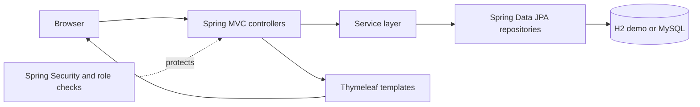
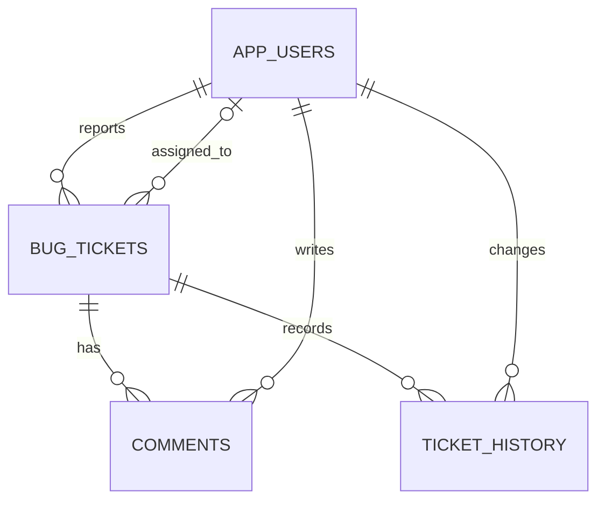

# Software Bug & Ticket Tracking System

BugTrack is a Java web application for reporting, assigning, and tracking software defects. It gives administrators a consolidated view of tickets and developers a focused view of assigned and reported work. Comments and a ticket history keep discussion and changes associated with each issue.

## Project overview

### Problem statement

Small teams often record bugs in chats, email, or spreadsheets. That can leave reports difficult to find, ownership unclear, priorities inconsistent, and status changes without an audit trail. BugTrack centralizes those reports in a role-based application.

### Objectives

- Capture bug reports with descriptions, categories, priorities, and severities.
- Assign tickets to developers and track them through defined status transitions.
- Keep comments and change history with each ticket.
- Provide role-appropriate dashboards, search, and filtering.
- Demonstrate a layered Java/Spring application with relational persistence and automated tests.

### Features

- Landing page, sign-in, and role-based administrator/developer workspaces.
- Ticket creation, viewing, editing, assignment, filtering, and status workflow.
- Comments and ticket activity history.
- Administrator user management; access can be revoked while identity and historical attribution are retained.
- Demo seed data with one administrator, three developers, and twelve sample tickets.
- H2 in-memory demo profile; optional MySQL configuration for persistent use.

## Technology stack

| Area | Technology |
| --- | --- |
| Language/runtime | Java 21 |
| Application framework | Spring Boot 3.5.8 |
| Web/UI | Spring MVC, Thymeleaf, Bootstrap 5.3.8, Bootstrap Icons |
| Persistence | Spring Data JPA, Hibernate |
| Security and validation | Spring Security, BCrypt password encoding, Jakarta Bean Validation |
| Databases | H2 for demo/tests; MySQL 8 for optional persistent use |
| Build and tests | Apache Maven 3.9+, JUnit 5, Spring Boot Test, MockMvc |

## Requirements

- JDK 21 (the `java` executable must be on `PATH`).
- Apache Maven 3.9 or newer (the project does not include Maven Wrapper).
- A modern browser.
- MySQL Server 8 only for the optional MySQL configuration; it is not needed for the demo or tests.
- VS Code is optional. The Java Extension Pack is helpful for editing, but Maven can build the project independently.

Check Java and Maven in PowerShell:

```powershell
java -version
mvn -version
```

If PowerShell says `mvn` is not recognized, add the existing Maven `bin` directory to the Windows user `PATH`, then open a new terminal. Maven can also be run with its full path, for example:

```powershell
& "C:\path\to\apache-maven\bin\mvn.cmd" -version
```

Use the actual installation path on your computer in place of the example.

## Project structure

```text
Software-Bug-Tracking-System/
|-- Dockerfile                            # Multi-stage Java 21 image for Render deployment
|-- .env.example                         # MySQL environment-variable names/example only
|-- .gitignore
|-- pom.xml
|-- README.md
|-- database/
|   `-- schema.sql                       # Optional MySQL schema script
|-- docs/
|   `-- Project-Report.md
`-- src/
    |-- main/
    |   |-- java/com/bugtracker/         # Application, MVC, services, repositories, entities
    |   `-- resources/
    |       |-- application.properties   # Default/optional MySQL configuration
    |       |-- application-demo.properties
    |       |-- static/css/              # Stylesheets
    |       |-- static/js/               # Browser scripts
    |       `-- templates/               # Thymeleaf pages and fragments
    `-- test/
        |-- java/com/bugtracker/         # Automated tests
        `-- resources/application-test.properties
```

Generated `target/` output and IDE-specific files are not part of the source submission.

## Architecture

The browser sends requests to Spring MVC controllers. Controllers use services for business rules; services use Spring Data repositories to access JPA entities. Thymeleaf renders the server-side pages. Spring Security protects routes and actions according to the signed-in user's role.



## Database design

The main entities are:

| Entity/table | Purpose |
| --- | --- |
| `User` / `app_users` | Account identity, role, access state, and BCrypt password hash |
| `BugTicket` / `bug_tickets` | Ticket ID, description, category, priority, severity, status, reporter, and optional assignee |
| `Comment` / `comments` | Discussion entries attached to a ticket and author |
| `TicketHistory` / `ticket_history` | Recorded ticket actions and the user who made each change |

Tickets reference a reporter and optionally an assignee. Comments and history belong to a ticket and retain their author/actor. The SQL schema is in `database/schema.sql`; Hibernate creates or updates the schema from the entity mappings at startup.



## Run locally with the H2 demo profile

The demo profile does not use MySQL or require MySQL credentials. H2 runs in memory, Hibernate creates the schema, and synthetic demo content is inserted only when the user table is empty. The database is configured with `create-drop`; demo data is temporary and resets when the application stops.

From the project directory (the directory containing `pom.xml`), run in PowerShell:

```powershell
mvn spring-boot:run "-Dspring-boot.run.profiles=demo"
```

Open [http://localhost:8080](http://localhost:8080). Stop the application with `Ctrl+C` in the terminal running Maven.

### Demonstration accounts

These synthetic accounts are seeded by `DemoDataLoader` when the `demo` profile starts with an empty user table. The same profile powers the public Render demo, so these are public sample credentials, not private or production credentials. Anyone can sign in with them; do not enter real, sensitive, or confidential data.

| Role | Username | Password |
| --- | --- | --- |
| Administrator | `admin` | `Admin@123` |
| Developer | `priya` | `Dev@1234` |

Passwords are encoded through the application's Spring Security password encoder before storage. Other sample developer accounts are seeded for assignment scenarios.

### Suggested demonstration

1. Sign in as the administrator and review the dashboard.
2. Open **All Tickets** to search and filter the seeded tickets.
3. Open a ticket to review its details, comments, and history.
4. Open **Users** and inspect a user's profile and access controls.
5. Sign out and sign in as the developer to review assigned/reported tickets and the developer dashboard.
6. Create a test ticket or add a comment/status update if you want to demonstrate changes. The in-memory data resets when the app stops.

## Public Render deployment

The application is deployed at [https://bugtrack-java.onrender.com](https://bugtrack-java.onrender.com). On 26 November 2026, Render reported the service as live, and the public homepage and `/login` both returned HTTP 200.

- **Hosting:** Render free web-service plan; no paid database is attached.
- **Deployment branch:** `render-deploy`. Render automatically deploys commits pushed to this branch.
- **Container:** [`Dockerfile`](Dockerfile) builds the application with Maven and Java 21, then runs it on a Java 21 runtime.
- **Runtime configuration:** The container activates the `demo` Spring profile and binds Spring Boot to Render's `PORT` environment variable.
- **Data:** The demo uses in-memory H2. Tickets and accounts are temporary and can reset when the service restarts or is redeployed.

The public demo uses the sample accounts above. Do not use the hosted demo for private or production data. To deploy application changes, merge or apply them to `render-deploy` while preserving the Dockerfile; pushes to that branch trigger Render deployments.

## Optional MySQL setup

The default `application.properties` points to a local MySQL database named `bugtracker`. It reads these environment variables:

| Variable | Default/meaning |
| --- | --- |
| `DB_URL` | Local `bugtracker` JDBC URL; includes `createDatabaseIfNotExist=true` |
| `DB_USER` | `root` unless overridden |
| `DB_PASSWORD` | Empty by default; set a local MySQL password if required |

The `.env.example` file documents variable names only. Spring Boot does **not** load `.env` files automatically; set environment variables in your terminal, VS Code launch configuration, or another local secret-management mechanism. Do not commit real passwords.

Example PowerShell setup for the non-secret settings:

```powershell
$env:DB_URL = "jdbc:mysql://localhost:3306/bugtracker?createDatabaseIfNotExist=true&useSSL=false&allowPublicKeyRetrieval=true&serverTimezone=UTC"
$env:DB_USER = "your_mysql_user"
# Set DB_PASSWORD locally using your own secure process; do not put it in this file or source control.
mvn spring-boot:run
```

Hibernate updates the MySQL schema on startup. Alternatively, review/run `database/schema.sql` with MySQL Workbench or the MySQL command-line client. Demo-account seeding is disabled for the default MySQL configuration and enabled only for the H2 demo profile.

## Build and tests

Run the automated test suite:

```powershell
mvn clean test
```

Tests use the H2 test profile and do not require MySQL. The suite covers status transitions, ticket/service behavior, and role-based access using JUnit 5, Spring Boot Test, and MockMvc.

Latest verification: `mvn test` completed successfully with **32 tests run, 0 failures, 0 errors, and 0 skipped**. The Render Docker build also completed and the hosted service was verified live.

Build the executable JAR:

```powershell
mvn package
```

Run the packaged application:

```powershell
java -jar target\bug-ticket-tracker-1.0.0.jar
```

To run that JAR with demo data instead of the default MySQL profile:

```powershell
java -jar target\bug-ticket-tracker-1.0.0.jar --spring.profiles.active=demo
```

## Screenshots

These are genuine screenshots captured from the running public demo at [bugtrack-java.onrender.com](https://bugtrack-java.onrender.com), not recreated mockups. They show seeded sample data. The login screenshot does not expose credentials; form-validation screenshots contain only empty submissions. No ticket, user, comment, assignment, or status changes were submitted while capturing them.

| Screenshot | Page or feature |
| --- | --- |
| [01-landing-page.png](docs/screenshots/01-landing-page.png) | Public landing page |
| [02-login-page.png](docs/screenshots/02-login-page.png) | Sign-in page |
| [03-admin-dashboard.png](docs/screenshots/03-admin-dashboard.png) | Administrator dashboard |
| [04-admin-all-tickets.png](docs/screenshots/04-admin-all-tickets.png) | Administrator ticket list |
| [05-admin-create-ticket-form.png](docs/screenshots/05-admin-create-ticket-form.png) | Ticket creation form |
| [06-admin-ticket-details.png](docs/screenshots/06-admin-ticket-details.png) | Administrator ticket details |
| [07-admin-edit-ticket.png](docs/screenshots/07-admin-edit-ticket.png) | Ticket edit form |
| [08-admin-ticket-comments.png](docs/screenshots/08-admin-ticket-comments.png) | Ticket comments |
| [09-admin-ticket-assignment-status-history.png](docs/screenshots/09-admin-ticket-assignment-status-history.png) | Assignment, status, and activity history controls |
| [10-admin-user-management.png](docs/screenshots/10-admin-user-management.png) | User list and user creation form |
| [11-admin-user-creation-validation.png](docs/screenshots/11-admin-user-creation-validation.png) | User creation validation |
| [12-admin-user-details.png](docs/screenshots/12-admin-user-details.png) | User details |
| [13-admin-user-access-management.png](docs/screenshots/13-admin-user-access-management.png) | User access management |
| [14-developer-dashboard.png](docs/screenshots/14-developer-dashboard.png) | Developer dashboard |
| [15-developer-assigned-tickets.png](docs/screenshots/15-developer-assigned-tickets.png) | Developer assigned tickets |
| [16-developer-reported-tickets.png](docs/screenshots/16-developer-reported-tickets.png) | Developer reported tickets |
| [17-developer-assigned-reported-tickets.png](docs/screenshots/17-developer-assigned-reported-tickets.png) | Developer assigned and reported tickets |
| [18-developer-ticket-details.png](docs/screenshots/18-developer-ticket-details.png) | Developer ticket details |
| [19-developer-comments-status-interface.png](docs/screenshots/19-developer-comments-status-interface.png) | Developer comment and status controls |
| [20-developer-access-denied.png](docs/screenshots/20-developer-access-denied.png) | Access-denied page (expected HTTP 403) |
| [21-ticket-validation-errors.png](docs/screenshots/21-ticket-validation-errors.png) | Ticket form validation |

## Troubleshooting

| Symptom | Checks |
| --- | --- |
| `mvn` is not recognized | Confirm Maven is installed, add its `bin` directory to the Windows user `PATH`, open a new terminal, or invoke `mvn.cmd` by full path. |
| `java` is not recognized or wrong version | Run `java -version`; ensure JDK 21 is installed and its `bin` directory is on `PATH`. |
| Port 8080 is already in use | Check the owning process before taking action: `Get-NetTCPConnection -LocalPort 8080 -State Listen`. Do not terminate an unknown process. |
| MySQL connection fails | Confirm MySQL 8 is running, verify `DB_URL`/`DB_USER`, and set the correct `DB_PASSWORD` in the local environment. H2 demo mode avoids this dependency. |
| Demo data disappears after stop | Expected: H2 is in-memory and uses `create-drop`. Use MySQL for persistent local data. |
| Sign-in fails in demo mode | Start with the `demo` profile and use one of the synthetic account pairs above. Seed data is not loaded if the user table already contains records. |

## GitHub and deployment branches

The source is hosted on GitHub. The `render-deploy` branch contains the deployment-only Dockerfile and is connected to the public Render service; `main` remains the application development branch. To publish application changes, merge or apply them to `render-deploy` and push that branch. Render is configured to deploy new commits automatically.

Review staged files before pushing. Do not commit real credentials or generated `target/` files; `.gitignore` excludes build output, IDE files, logs, and local secret files.

## Author and institution

The existing project report records the following attribution: **Jaya**, Computer Science & Engineering, **SRM University, AP**. Confirm these details before submitting if your official project information differs.

## Future enhancements

- Add ticket attachments and email notifications.
- Add project-level grouping, reporting charts, and export.
- Add a persistent production database and production-ready account/secret management.
- Add a REST API and optional container orchestration.
- Expand automated browser-level coverage and accessibility checks.

For the academic project report and technical discussion, see [`docs/Project-Report.md`](docs/Project-Report.md).
