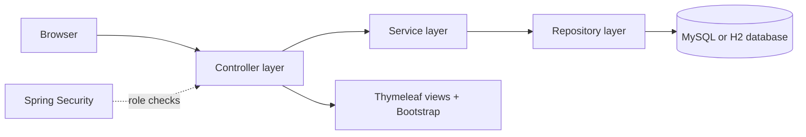
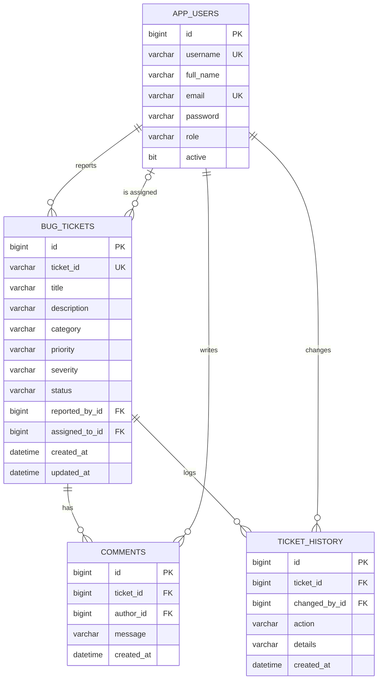
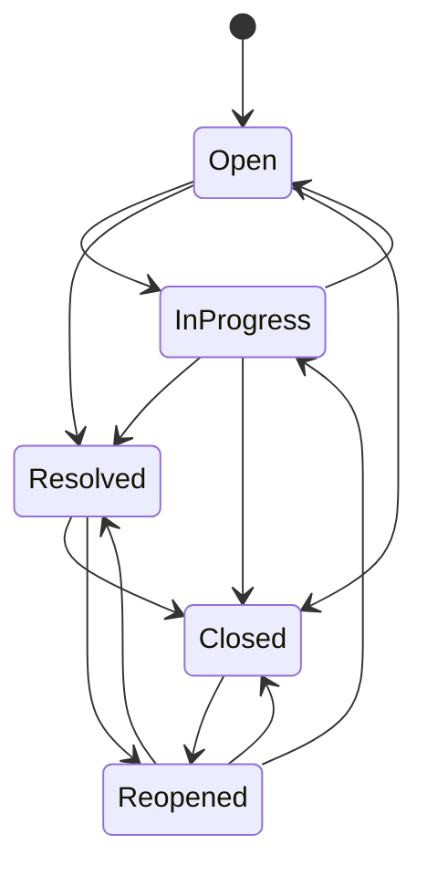

# SOFTWARE BUG & TICKET TRACKING SYSTEM
### A Project Report submitted for the B.Tech (CSE) Java Programming End-Semester Evaluation

**Student:** Jaya  |  **Department:** Computer Science & Engineering  |  **University:** SRM University, AP

---

## 1. Abstract
Software teams find bugs continuously, but without a proper system the reports are scattered across chats and e-mails. This project presents the *Software Bug & Ticket Tracking System*, a web application developed in Java with Spring Boot, Thymeleaf, Bootstrap, and JPA. Users report bugs as tickets with priority, severity and module; administrators assign tickets to developers; developers update progress and discuss the issue in comments. Every change is stored in a history trail and dashboards show live statistics from the database. Role-based security with BCrypt-hashed passwords protects the system. Local demonstration and automated tests use H2; MySQL remains available for persistent use.

## 2. Introduction
Bug tracking is a core part of the software development life cycle. A ticket is a record that describes one defect from the moment it is reported until it is closed. Tools such as Jira and Bugzilla are widely used in industry. This project builds a simplified but fully working version of such a tool to apply Java OOP concepts, MVC architecture and database programming in a real application.

## 3. Problem Statement
Small teams and student groups often track bugs in messaging apps or spreadsheets. As a result bugs are forgotten, ownership is unclear, priorities are not visible, and there is no history of what happened. A central, role-based bug tracking system is needed.

## 4. Existing System
- Bugs reported verbally, by chat or e-mail.
- Spreadsheets maintained manually.
- No unique ticket numbers, no audit trail, no access control, no statistics.

## 5. Proposed System
A web application with unique ticket ids, enforced status workflow, role-based access (Admin / Developer), comments, history and dashboards. Data is stored in MySQL for persistent use or in H2 for local demonstration and tests.

## 6. Objectives
1. Report bugs with complete details and automatic ticket ids.
2. Assign tickets to developers.
3. Track status: Open, In Progress, Resolved, Closed, Reopened.
4. Record comments and a full change history.
5. Provide search and filtering.
6. Provide dashboards with real database statistics.
7. Secure the system with authentication and roles.

## 7. Requirements
**Functional:** login/logout; manage users; create, view, edit, delete tickets; assign; change status; comment; search/filter; dashboards.
**Non-functional:** responsive UI, password hashing, input validation, readable code, easy local setup.

| Type | Requirement |
| --- | --- |
| Software | JDK 21, Maven 3.9+, H2 for demo/tests, optional MySQL 8 for persistent use, modern browser |
| Hardware | 4 GB RAM, any Windows 10/11 PC |

## 8. Architecture
The application follows the **MVC** pattern with a layered design.

| Layer | Responsibility | Classes |
| --- | --- | --- |
| View | HTML pages | templates/*.html |
| Controller | Handles requests | AuthController, DashboardController, TicketController, UserController |
| Service | Business rules | UserService, TicketService, DashboardService |
| Repository | Database access | UserRepository, BugTicketRepository, CommentRepository, TicketHistoryRepository |
| Entity | Tables as Java classes | User, BugTicket, Comment, TicketHistory |

## 9. Modules
1. **Authentication & Roles** - form login, `CustomUserDetailsService`, BCrypt, `@PreAuthorize`, URL rules.
2. **Admin Dashboard** - totals, open, in-progress, resolved, critical, status/priority distribution, recent tickets.
3. **Bug Reporting** - validated form, auto ticket id (`BUG-1000 + id`).
4. **Ticket Management** - list, search, filter, details, edit, delete with confirmation modal, assignment.
5. **Status Tracking** - workflow enforced by `Status.allowedNext()`.
6. **Developer Dashboard** - assigned tickets, own statistics.
7. **Comments & History** - discussion and audit trail.
8. **User Management** - create and deactivate users, permanently revoke login access while retaining identity and work history for accountability, prevent duplicate usernames and e-mails.

## 10. Database Design
Tables: `app_users`, `bug_tickets`, `comments`, `ticket_history`. SQL is in `database/schema.sql`.

### ER Diagram

### Status workflow

## 11. Implementation
**Java OOP concepts used**
- *Classes and objects:* every entity, service and controller.
- *Encapsulation:* private fields with getters/setters in all entities and DTOs.
- *Inheritance:* `BaseEntity` (id, created/updated time) is extended by all four entities.
- *Interfaces:* `Labelled` (implemented by `Status`, `Priority`, `Severity`, `Category`, `Role`); Spring Data repositories; `UserDetailsService`.
- *Abstraction:* `BaseEntity` is abstract; services hide database details from controllers.
- *Polymorphism:* `DashboardService.item(Labelled)` works with any `Labelled` enum; `@Override` methods in enums and `CustomUserDetailsService`.
- *Collections:* `List`, `EnumSet`, `Set` for tickets, comments and allowed statuses.
- *Exception handling:* `ResourceNotFoundException`, `DuplicateUserException`, `InvalidStatusChangeException`, `GlobalExceptionHandler`.
- *MVC:* controllers + Thymeleaf views + entity model.

**Security:** BCrypt hashing, form login, role rules in `SecurityConfig`, `@PreAuthorize("hasRole('ADMIN')")` on edit/delete/assign, CSRF tokens on all forms, ownership checks in `TicketService`.

**Validation:** Bean Validation annotations (`@NotBlank`, `@Size`, `@NotNull`, `@Email`, `@Pattern`) on `TicketForm` and `UserForm`, with messages shown beside each field.

**Frontend:** Thymeleaf fragments (sidebar, top bar, badges, confirmation modal), Bootstrap 5, custom blue/white/grey theme in `app.css`, small `app.js` for mobile menu and delete confirmation.

## 12. Testing
Tests use JUnit 5, Spring Boot Test, MockMvc and an in-memory H2 database (`mvn test`).

| Test class | What it checks |
| --- | --- |
| `StatusTransitionTest` | Status workflow rules (unit test) |
| `TicketServiceTest` | Creating a bug, ticket-id generation, search/filter, status update and invalid moves, comments, deleting tickets with their comments/history, dashboard statistics, duplicate users, password hashing, and retained identity after access removal |
| `SecurityAccessTest` | Anonymous redirect, admin/developer page access, forbidden actions, user-access removal permissions, CSRF |

Latest verification in the current workspace: `mvn package` completed with **32 tests run, 0 failures, 0 errors, and 0 skipped**. This command compiled, ran the tests, and packaged the executable JAR. Tests use H2 and do not require MySQL.

## 13. Results
The application has been verified locally using the H2 demo profile. The landing page, authenticated administrator dashboard, ticket list, and authenticated developer dashboard were loaded in a browser. The demo loader supplies one administrator, three developers, and twelve sample tickets with varied priorities, severities, statuses, and comments.

Automated tests cover status transitions, ticket/service behavior, and role-based access. The latest Maven package run passed all 32 tests. These results confirm the covered code paths; they should not be read as a claim that every possible browser workflow or deployment environment has been exhaustively tested.

## 14. Conclusion
The system replaces scattered bug reporting with a structured, secure, database-backed web application. It demonstrates MVC, layered architecture, JPA relationships, validation, role-based security and OOP principles in one project.

## 15. Future Scope
- File/screenshot attachments on tickets.
- E-mail notifications on assignment and status change.
- Reporter role and project-wise grouping.
- Charts with a JavaScript chart library, CSV/PDF export.
- REST API and mobile client; deployment with Docker.
